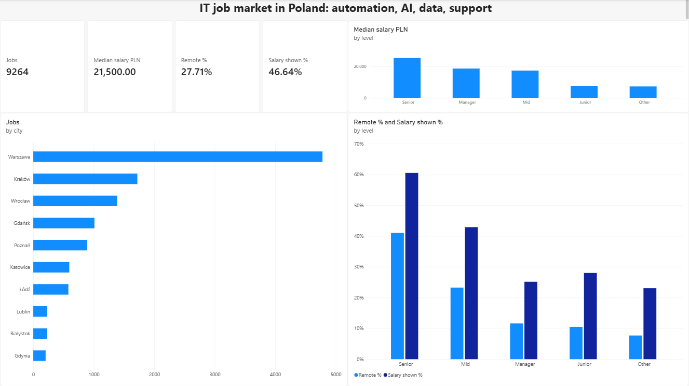

# IT job market in Poland: automation, AI, data, support

A one-page Power BI report built on 9,264 public job postings in Poland (snapshot: 30 September 2026).



## What the data says

| Level | Postings | Median salary (PLN / month) | Remote | Salary shown |
|---|---|---|---|---|
| Junior | 953 | 7,500 | 10% | 28% |
| Mid | 4,174 | 17,200 | 23% | 43% |
| Senior | 3,465 | 25,200 | 41% | 60% |

- The median salary more than doubles between junior and mid level.
- Remote work is offered in 41% of senior postings but only 10% of junior ones, so entry-level candidates should expect on-site roles.
- Employers publish a salary range in 60% of senior postings and only 28% of junior ones.
- Warszawa alone accounts for 4,780 postings, about half of the sample.

## Data

Public job postings in Poland, collected by my personal job-search tool. The sample follows my own search profile (automation, AI, Python, data and BI, IT support), so it describes that slice of the market and not the whole of it.

Raw data and the `.pbix` file are not published here. The report contains aggregates only.

## Model

- `jobs`: one row per posting.
- `job_cities`: one row per posting and city. A posting can be open in several cities at once.
- Relationship `jobs[job_id]` 1 to many `job_cities[job_id]`, cross-filter direction set to **Both**.

With the default single direction, a city selected on a visual did not filter `jobs`, and every city showed the full 9,264 postings. Setting the direction to Both fixed it. City totals add up to more than 9,264 because a multi-city posting is counted in each of its cities, while the grand total stays at the distinct number of postings.

## Data preparation (Power Query)

1. Kept postings located in Poland.
2. Turned free-text salaries into a monthly midpoint in PLN with a custom function. Every source writes salaries differently: `8 000–11 000 zł netto (+ VAT) / mies.`, `150-170 PLN/hour b2b`, `12000-17000 PLN/month b2b; 11000-16000 PLN/month permanent`.
3. Merged duplicate city names (`Warsaw` into `Warszawa`, `Krakow` and `Cracow` into `Kraków`, and so on).
4. Mapped 75 different seniority labels to five levels: Junior, Mid, Senior, Manager, Other.

```
(t as nullable text) as nullable number =>
let
    s0 = if t = null then "" else Text.Lower(Text.BeforeDelimiter(t & ";", ";")),
    s  = Text.Remove(Text.Replace(Text.Replace(s0, "b2b", ""), "#(2013)", "-"), {" ", "#(00A0)"}),
    tokens = List.Select(Text.SplitAny(s, Text.Remove(s, {"0".."9"})), each _ <> ""),
    lo = Number.From(tokens{0}),
    hi = if List.Count(tokens) > 1 then Number.From(tokens{1}) else lo,
    k  = if Text.Contains(s, "hour") or Text.Contains(s, "godz") or Text.Contains(s, "/hr") then 168
         else if Text.Contains(s, "day") then 21
         else if Text.Contains(s, "year") then 1 / 12
         else 1,
    isPLN = Text.Contains(s, "pln") or Text.Contains(s, "zł"),
    result = if List.Count(tokens) = 0 or not isPLN or hi < lo or lo * k < 2000 or hi * k > 100000
             then null else (lo + hi) / 2 * k
in
    result
```

## Measures (DAX)

```
Jobs = COUNTROWS(jobs)
Jobs with salary = COUNT(jobs[salary_mid_pln])
Median salary PLN = MEDIAN(jobs[salary_mid_pln])
Salary shown % = DIVIDE([Jobs with salary], [Jobs])
Remote % = DIVIDE(CALCULATE([Jobs], jobs[remote] = 1), [Jobs])
```

Median is used instead of average because a few very high ranges pull the average up.

## Assumptions and limits

- Salary is the midpoint of the published range. Hourly rates are converted with 168 hours per month, daily rates with 21 days, yearly amounts are divided by 12.
- 4,377 postings had a salary text, 4,321 were parsed. The other 56 (1.3%) were left empty on purpose: a foreign currency, or a monthly amount outside 2,000 to 100,000 PLN. Some of those are mistakes in the postings themselves, for example an hourly rate labelled as monthly.
- B2B net amounts and gross employment salaries are not converted to a common basis, so medians are indicative.
- When a posting lists several levels (for example "junior / mid"), it is counted at the lowest one.

## Validation

Every number in the report was checked against an independent calculation in Python on the same files: row counts, parsed salaries, medians per level, postings per city. All matched exactly. The check caught one real error during the build, a city name replaced with the wrong first letter, which left 89 postings outside their city.

## Tools

Power BI Desktop, Power Query (M), DAX, Python for data collection and validation.

## How I built it

This is my first Power BI project. I learned the tool with an AI assistant as a tutor: it drafted the M and DAX code and explained every step, and I built the model and the visuals by hand and answered a control question after each step. It was a fun way to learn, and I can walk through any part of the report.
